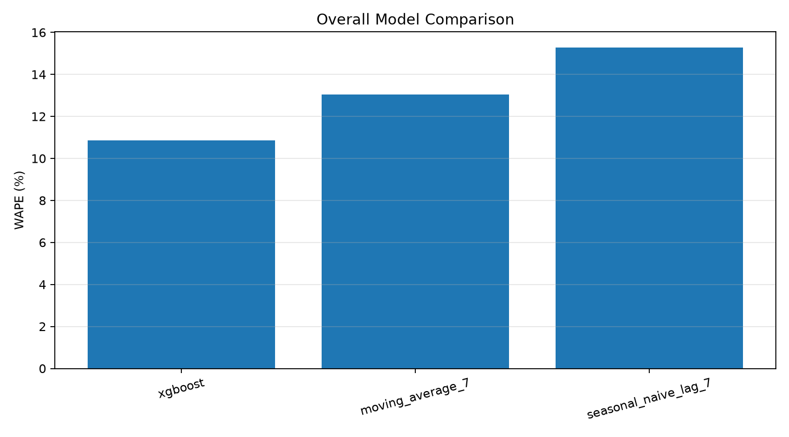
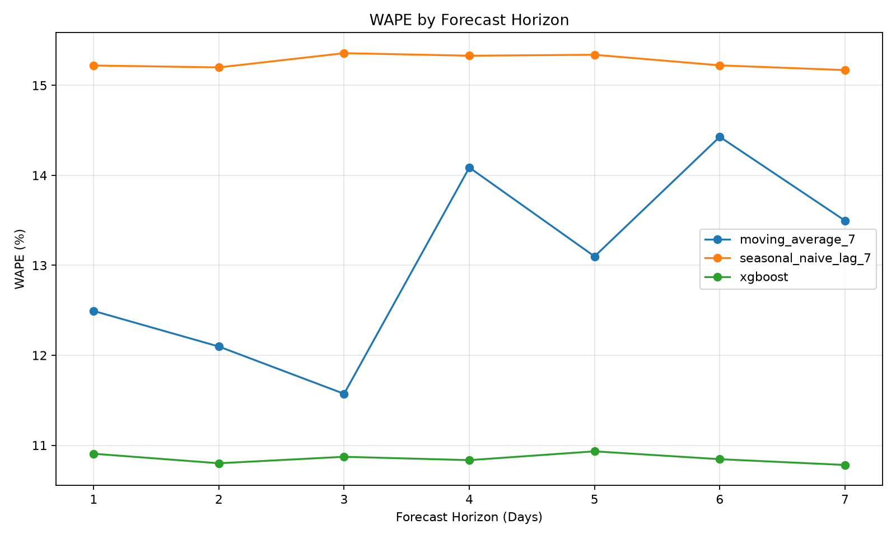
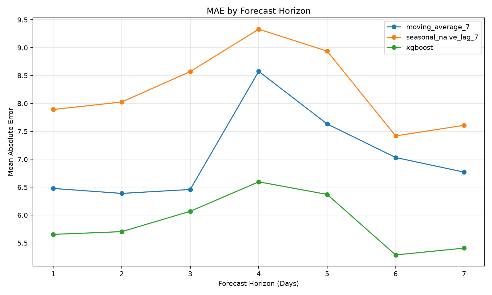

# Synthetic Demand Forecasting — Model Evaluation

## Data disclosure

**Data source: SYNTHETIC.**

All observations are artificially generated for a portfolio demonstration. Results do not represent real retailer transactions or real-world performance.

## Evaluation methodology

- Backtest origins: 12
- Store-item combinations: 500
- Recursive forecast horizon: 7 days
- Predictions per model: 42,000
- Models: XGBoost, 7-day moving average, and 7-day seasonal naive.
- All models use the same rolling evaluation windows.

## Overall model performance

| model                |   records |   MAE |   RMSE |   WAPE_percent |   sMAPE_percent |
|:---------------------|----------:|------:|-------:|---------------:|----------------:|
| xgboost              |     42000 | 5.869 |  8.157 |         10.854 |          10.83  |
| moving_average_7     |     42000 | 7.048 |  9.587 |         13.034 |          12.98  |
| seasonal_naive_lag_7 |     42000 | 8.256 | 11.327 |         15.267 |          15.116 |

## WAPE improvement

XGBoost achieved:
- **16.72% lower WAPE** than the 7-day moving average.
- **28.91% lower WAPE** than the 7-day seasonal naive baseline.

## Performance across forecast horizons

| model                |   horizon_day |   MAE |   RMSE |   WAPE_percent |   sMAPE_percent |
|:---------------------|--------------:|------:|-------:|---------------:|----------------:|
| moving_average_7     |             1 | 6.477 |  8.603 |         12.493 |          12.339 |
| seasonal_naive_lag_7 |             1 | 7.892 | 10.751 |         15.221 |          15.116 |
| xgboost              |             1 | 5.654 |  7.745 |         10.906 |          10.877 |
| moving_average_7     |             2 | 6.388 |  8.706 |         12.097 |          11.934 |
| seasonal_naive_lag_7 |             2 | 8.027 | 11.153 |         15.2   |          14.943 |
| xgboost              |             2 | 5.703 |  7.975 |         10.8   |          10.757 |
| moving_average_7     |             3 | 6.459 |  9.015 |         11.572 |          11.528 |
| seasonal_naive_lag_7 |             3 | 8.572 | 11.738 |         15.358 |          15.076 |
| xgboost              |             3 | 6.068 |  8.449 |         10.872 |          10.822 |
| moving_average_7     |             4 | 8.576 | 11.741 |         14.087 |          14.402 |
| seasonal_naive_lag_7 |             4 | 9.332 | 12.874 |         15.33  |          15.088 |
| xgboost              |             4 | 6.596 |  9.227 |         10.835 |          10.789 |
| moving_average_7     |             5 | 7.633 | 10.557 |         13.099 |          13.312 |
| seasonal_naive_lag_7 |             5 | 8.939 | 12.131 |         15.34  |          15.245 |
| xgboost              |             5 | 6.37  |  8.757 |         10.933 |          10.916 |
| moving_average_7     |             6 | 7.032 |  9.152 |         14.428 |          14.065 |
| seasonal_naive_lag_7 |             6 | 7.419 | 10.06  |         15.223 |          15.227 |
| xgboost              |             6 | 5.285 |  7.284 |         10.845 |          10.878 |
| moving_average_7     |             7 | 6.77  |  8.905 |         13.497 |          13.279 |
| seasonal_naive_lag_7 |             7 | 7.609 | 10.306 |         15.17  |          15.121 |
| xgboost              |             7 | 5.408 |  7.478 |         10.781 |          10.774 |

XGBoost has the lowest MAE, RMSE, WAPE, and sMAPE at each of the seven forecast horizons.

Its WAPE ranges from **10.78%** to **10.93%** across the seven days.

## Visualizations

### Overall WAPE comparison

### WAPE by forecast horizon

### MAE by forecast horizon

## Conclusion

On this synthetic portfolio dataset, XGBoost outperformed both
statistical baselines across all evaluated metrics and forecast horizons.

These results demonstrate the evaluation workflow and model's performance
on simulated data. They do not establish real-world retail forecasting
performance. Further validation on genuine retailer data is required.
